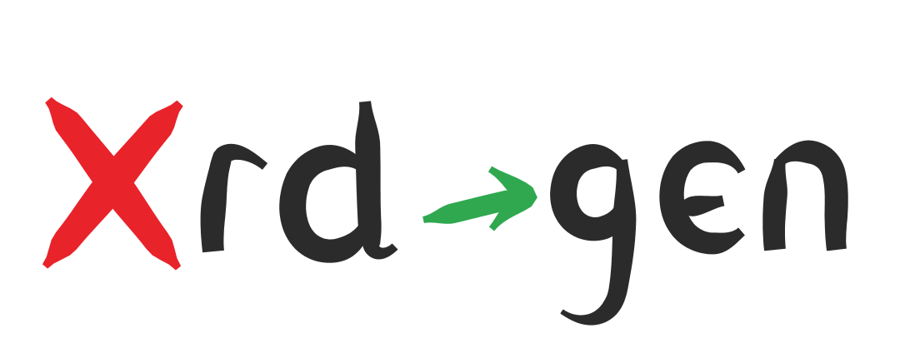

# xrd-gen

<p align="center">
  
</p>

A code generation tool for Crossplane that generates [Crossplane XRD](https://docs.crossplane.io/latest/composition/composite-resource-definitions/) YAML definitions from Go struct definitions.

## Overview

`xrd-gen` is a CLI tool inspired by [controller-gen](https://book.kubebuilder.io/reference/controller-gen) from the Kubernetes controller-tools project. While controller-gen generates Kubernetes Custom Resource Definitions (CRDs) from Go types, `xrd-gen` focuses on generating Crossplane Composite Resource Definitions (XRDs) along with the necessary boilerplate code like `DeepCopy` methods.

The tool follows similar annotation conventions to controller-gen, allowing you to define your API types in Go using struct tags and comments, then automatically generate:
- Crossplane XRD YAML manifests (v2 format)
- DeepCopy boilerplate methods for Kubernetes runtime compatibility
- Unit tests for the generated DeepCopy methods

## Quick Start

### Installation

Build the binary:

```bash
earthly +build
```

The binary is at `_output/bin/<os>_<arch>/xrd-gen`, and `bin/xrd-gen` for the host platform.

### Basic Usage

Generate XRD YAML and DeepCopy boilerplate from Go structs:

```bash
./bin/xrd-gen go:xrd \
  --input-path=./path/to/go/types \
  --output-path=./path/to/output
```

### Command-line Options

- `--input-path` (required): Path to the Go source code directory containing your type definitions
- `--output-path` (required): Path where generated YAML files will be written
- `--header-file` (optional): Path to a file containing a header comment to be added to generated Go files
- `--generate-deepcopy-tests` (optional, default: true): Generate basic unit tests for DeepCopy methods

### Example

Given Go types with annotations:

```go
// +xrd-gen:object:root=true
// +xrd-gen:groupName=example.com
// +xrd-gen:version=v1alpha1
// +xrd-gen:label:app.kubernetes.io/name=mydb
// +xrd-gen:label:app.kubernetes.io/managed-by=xrd-gen
// +xrd-gen:annotation:description="Database cluster composite resource"
// +xrd-gen:printcolumn:name="version",type="string",JSONPath=".spec.version",description="Engine version"
// +xrd-gen:printcolumn:name="health",type="string",JSONPath=".status.health"
// +xrd-gen:printcolumn:name="nodes",type="integer",JSONPath=".status.nodeCount",description="Number of nodes",priority=1

// XMyDB defines a Crossplane composite resource for database clusters
type XMyDB struct {
    metav1.TypeMeta   `json:",inline"`
    metav1.ObjectMeta `json:"metadata,omitempty"`
    
    Spec   XMyDBSpec   `json:"spec"`
    Status XMyDBStatus `json:"status,omitempty"`
}

type XMyDBSpec struct {
    // Version of the database engine
    // +xrd-gen:validation:Default=17.2
    // +xrd-gen:validation:XValidation:rule="self == oldSelf",message="version is immutable"
    Version string `json:"version"`
    
    // NodeSets define groups of database nodes
    // +xrd-gen:validation:MinItems=1
    NodeSets []NodeSet `json:"nodeSets"`
    
    // Replicas is the number of replicas
    // +xrd-gen:validation:Default=1
    // +xrd-gen:validation:Minimum=1
    // +xrd-gen:validation:Maximum=10
    Replicas int32 `json:"replicas,omitempty"`
}
```

Running `./bin/xrd-gen go:xrd --input-path=./api --output-path=./xrds` will generate:
- `xrds/xmydb.yaml` - The XRD manifest
- `api/zz_generated.deepcopy.go` - DeepCopy methods
- `api/zz_generated.deepcopy_test.go` - Tests for DeepCopy methods

### Supported Annotations

**Struct-level annotations:**
- `+xrd-gen:object:root=true` - Marks the struct as a root XRD type
- `+xrd-gen:groupName=<group>` - Specifies the API group (e.g., `example.com`)
- `+xrd-gen:version=<version>` - Specifies the API version (defaults to `v1alpha1`)
- `+xrd-gen:plural=<name>` - Specifies a custom plural name for the resource
- `+xrd-gen:label:<key>=<value>` - Adds a Kubernetes label to the XRD metadata (can be repeated). Values with spaces should be quoted.
- `+xrd-gen:annotation:<key>=<value>` - Adds a Kubernetes annotation to the XRD metadata (can be repeated). Values with spaces should be quoted.
- `+xrd-gen:printcolumn:<params>` - Defines additional columns to display in `kubectl get` output (can be repeated)
  - Parameters (comma-separated):
    - `name=<string>` (required) - Column name
    - `type=<string>` (required) - Column type (string, integer, number, boolean, date)
    - `JSONPath=<string>` (required) - JSONPath expression to the field
    - `description=<string>` (optional) - Human-readable description
    - `priority=<int>` (optional) - Priority (0=always shown, >0=shown with -o wide)

**Field-level annotations:**
- `+xrd-gen:validation:Optional` - Marks a field as optional
- `+xrd-gen:validation:MinItems=<n>` - Sets minimum number of items for arrays
- `+xrd-gen:validation:MaxItems=<n>` - Sets maximum number of items for arrays
- `+xrd-gen:validation:Pattern=<regex>` - Sets regex pattern for string validation
- `+xrd-gen:validation:Minimum=<n>` - Sets minimum value for numeric fields
- `+xrd-gen:validation:Maximum=<n>` - Sets maximum value for numeric fields
- `+xrd-gen:validation:MinLength=<n>` - Sets minimum length for string fields
- `+xrd-gen:validation:MaxLength=<n>` - Sets maximum length for string fields
- `+xrd-gen:validation:Enum=<value1,value2,...>` - Restricts field to a set of allowed values
- `+xrd-gen:validation:Default=<value>` - Sets a default value for the field (works with enum, string, numeric, and boolean types)

**CEL validation annotations (struct-level and field-level):**
- `+xrd-gen:validation:XValidation:rule="<CEL expression>",message="<string>"` - Adds a [CEL validation rule](https://kubernetes.io/blog/2022/09/29/enforce-immutability-using-cel/) to the schema. Can be repeated to add multiple rules. Generates `x-kubernetes-validations` entries in the XRD YAML.
  - Parameters (comma-separated):
    - `rule=<CEL expression>` (required) - CEL expression that must evaluate to true. `self` refers to the current value.
    - `message=<string>` (optional) - Static error message shown on validation failure
    - `messageExpression=<CEL expression>` (optional) - CEL expression that evaluates to a dynamic error message
    - `reason=<reason>` (optional) - Machine-readable failure reason (`FieldValueRequired`, `FieldValueInvalid`, `FieldValueForbidden`, `FieldValueDuplicate`)
    - `fieldPath=<path>` (optional) - Relative JSON path to the failing field
    - `optionalOldSelf=<bool>` (optional) - When true, `oldSelf` becomes a CEL optional type for transition rules that also evaluate on creation

  Examples:
  ```go
  // Field-level: enforce immutability using a transition rule
  // +xrd-gen:validation:XValidation:rule="self == oldSelf",message="name is immutable"
  Name string `json:"name"`

  // Struct-level: cross-field validation
  // +xrd-gen:validation:XValidation:rule="self.minReplicas <= self.maxReplicas",message="minReplicas must not exceed maxReplicas"
  type ReplicaSpec struct { ... }
  ```

## Documentation

- **[Architecture](docs/architecture.md)** - Project structure, design principles, and dependencies
- **[Contributing](CONTRIBUTING.md)** - Building, testing, and opening a PR

## Future Work

The following features and improvements are planned for future releases:

### XRD to Go Generation

Currently, `xrd-gen` only supports generating XRD YAML from Go structs. A future enhancement would be to support the reverse direction: parsing existing XRD YAML files and generating Go type definitions. This would enable workflows where XRDs are authored first and Go types are derived from them.

Planned command:
```bash
xrd-gen xrd:go --input-path=./xrds --output-path=./api
```

### Enhanced Test Coverage for DeepCopy

While the tool generates unit tests for DeepCopy methods, there are opportunities to improve coverage:
- Property-based testing to ensure DeepCopy correctness for edge cases
- Verification that all fields are properly copied (no missed fields)
- Testing of circular reference handling
- Testing nested arrays and maps
