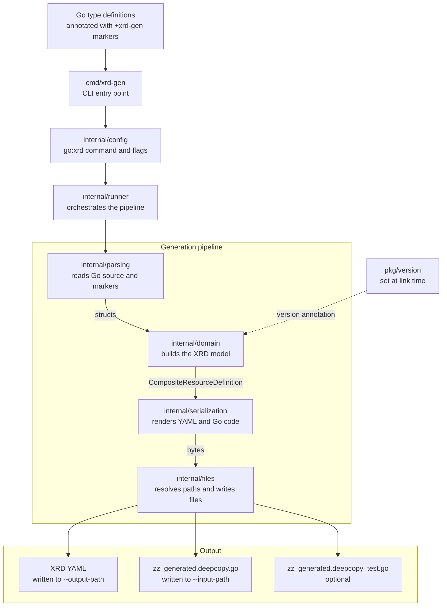

# Architecture

## Overview

`xrd-gen` is a one-shot CLI. It reads annotated Go type definitions, builds an
in-memory model of each XRD, then writes the rendered YAML and DeepCopy code
back to disk. Each layer has a single responsibility and hands its output to
the next one.

Only root structs, marked with `+xrd-gen:object:root=true`, become XRDs. The
DeepCopy code is written next to the types it is generated from rather than to
the output path, so it compiles as part of the same package.

## Structure

The CLI binary lives in `cmd/xrd-gen/main.go` and calls into the `internal`
package.

Separate packages under `internal` cover the individual aspects:
- `config` for CLI arg parsing.
- `parsing` for parsing the Go code or XRD YAML.
- `domain` for domain logic (e.g. creating the necessary information needed for a XRD YAML). No code or YAML parsing is done at this layer; instead this just uses the data provided by the `parsing` layer.
- `serialization` for converting domain structs into Go or YAML.
- `files` for writing files (e.g. using the right paths and filenames, and actually creating and writing the files).

There is no parsing or file writing in the domain layer. The domain layer does
not create YAML or Go directly either; it produces a struct holding all the
necessary information, which the `serialization` package then serializes.

`pkg/version` holds the version string, which is set at link time by the build
and ends up in the annotation on every generated XRD.

Comments are not necessary for every public function and struct, just when
things are complex or not obvious.

Where there is no state or shared variables required, a simple function is used
instead of a struct or interface.

## Dependencies

Use public, open-source dependencies where applicable. Use the Apache-2.0
license as much as possible. Other business-friendly licenses (e.g. MIT) are
fine as well.

The `+go-licenses-check` Earthly target enforces this: it fails the build if
anything linked into the released binary carries a license outside the
allow-list it declares.

## Workflow

Read [CONTRIBUTING.md](../CONTRIBUTING.md) for details about how to run the
tooling. Tests are written for all components (more below) and included with
changes to files. `earthly +reviewable` runs before every commit.

## Testing

Unit tests are expected for all functions and methods, and live alongside the
implementations.

On top of those, `integrationtest/` holds integration tests that run a built
`xrd-gen` binary against a dummy Go project in `integrationtest/testdata/` and
check the generated XRD YAML and DeepCopy code, including that the generated
code compiles. `earthly +test` runs these along with the unit tests.

The `TestCrossplane*` tests in the same package go further: they create a k3d
cluster, install Crossplane, apply a generated XRD to it, and create composite
resources against the resulting CRD to confirm that the schema and its CEL
validation rules behave as intended. They need a Docker daemon and are skipped
by `-short`, so they run under `earthly -P +e2e` rather than `earthly +test`.

Use the testify library for tests, specifically the `require` package, and
`assert.AnError` for any mock or stub errors.

## Installation

`earthly +build` writes `bin/xrd-gen` and `_output/bin/<os>_<arch>/xrd-gen`.
The tool is also installable with
`go install github.com/crossplane-contrib/xrd-gen/cmd/xrd-gen@latest`.
